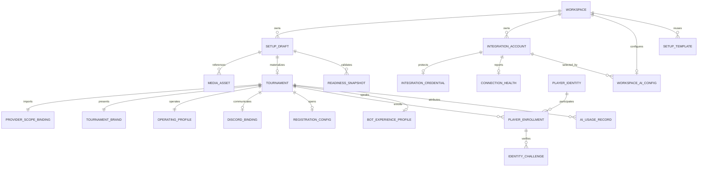

# Data Model: Tournament Setup Wizard, Player Registration, and Workspace AI Keys

PostgreSQL is the runtime source of truth. Every new operational row has a
non-null `workspace_id`; services obtain that value from the authenticated
principal or a claimed workspace-scoped job, never from an untrusted body alone.
UUIDs below are local identifiers. Timestamps are UTC `TIMESTAMPTZ`.

## Required identity prerequisite

Feature 003 must finish the migration from the current globally unique
`tournaments.slug` primary key to a stable local tournament UUID with a
workspace-scoped slug. The target invariant is:

- `tournaments.id UUID PRIMARY KEY`
- `tournaments.workspace_id UUID NOT NULL REFERENCES workspaces(id)`
- `UNIQUE (workspace_id, slug)`

Compatibility routes may still accept a slug, but resolve it together with the
session workspace. New wizard contracts and child tables use `tournament_id`.
This permits two workspaces to track the same remote Event and one workspace to
track different Events from one remote tournament.

## Entity overview



## `tournament_setup_drafts`

| Field | Type | Rules |
|---|---|---|
| `id` | UUID | Primary key |
| `workspace_id` | UUID | Required FK; included in every lookup |
| `created_by`, `updated_by` | UUID | Required user references |
| `status` | enum | `editing`, `ready`, `materialized`, `abandoned` |
| `current_step` | enum | `provider`, `tournament`, `discord`, `assistant`, `review` |
| `revision` | bigint | Starts at 1; increments on every accepted mutation |
| `schema_version` | integer | Version of `answers_json` validator |
| `provider_account_id` | UUID nullable | Same-workspace Start.gg/Challonge account |
| `provider_type` | enum nullable | `startgg`, `challonge`; must match account |
| `external_tournament_id` | text nullable | Canonical provider ID from a successful resolve |
| `external_scope_id` | text nullable | Exact Event/bracket ID; required for ready state |
| `external_tournament_slug` | text nullable | Canonical display/re-resolution locator |
| `external_scope_slug` | text nullable | Canonical Event/bracket locator |
| `provider_observed_at` | timestamptz nullable | Freshness basis for readiness |
| `discord_account_id` | UUID nullable | Same-workspace Discord guild installation |
| `ai_account_id` | UUID nullable | Same-workspace Gemini/OpenAI account selected for this setup |
| `logo_asset_id` | UUID nullable | Same-workspace draft-owned media asset |
| `answers_json` | JSONB | Validated non-secret step answers only |
| `completion_json` | JSONB | Derived step completion codes; no secrets/errors |
| `materialized_tournament_id` | UUID nullable | Set once; unique per draft |
| `expires_at` | timestamptz nullable | Retention policy; never expires an active materialization |
| `created_at`, `updated_at` | timestamptz | Required |

Validation:

- `revision > 0`; stale expected revisions fail without mutation.
- A recursive server allow-list rejects keys such as `api_key`, `token`,
  `password`, `authorization`, `cookie`, `secret`, and request headers.
- Selected account IDs are reloaded under the same workspace on every protected
  mutation. Provider type and account status must match the field purpose.
- Provider IDs are written only by the resolver, never trusted from an arbitrary
  autosave payload.
- `materialized_tournament_id` is immutable after first assignment.
- Abandoned/materialized drafts reject ordinary PATCH requests.

State transitions:

```text
editing --all required draft checks pass--> ready
ready --an answer or dependency changes--> editing
editing|ready --organizer abandons--> abandoned
ready --idempotent materialization succeeds--> materialized
```

Validation/readiness evidence is recomputed; a failure does not create a terminal
draft state.

## `integration_accounts` changes

Keep the existing table and encrypted credential separation. Complete these
invariants:

- Provider types include `startgg`, `challonge`, `discord`, `gemini`, `openai`.
- Uniqueness is `(workspace_id, provider_type, external_account_id)` rather than
  legacy `owner_id` uniqueness.
- For AI providers, initially permit at most one active/logical account per
  `(workspace_id, provider_type)`; rotating a key does not create a new account.
- A Discord managed-bot account represents one guild installation and stores the
  guild ID as its external identity. It never stores the platform bot token.
- Soft disable retains all dependent tournament bindings so their readiness can
  degrade and later recover.

Safe `metadata_json` may contain provider account display identity, granted scope
names, token expiry, Discord guild labels, or capability hints. It may not contain
access/refresh/API/bot tokens, raw provider responses, or credential fragments.

## `integration_credentials`

Reuse the existing encrypted store:

| Field | Type | Rules |
|---|---|---|
| `owner_kind` | enum | `account` or `application` |
| `owner_id` | UUID | Integration account/application identifier |
| `secret_type` | text | `api_key`, `access_token`, `refresh_token`, `client_secret`, etc. |
| `ciphertext` | text | Authenticated encryption under a service key outside PostgreSQL |
| `credential_revision` | bigint | Starts at 1; increments on atomic replacement |
| `created_at`, `updated_at` | timestamptz | Required |

Plaintext exists only in the secret input component, HTTPS request memory, and
the provider call stack. It is never returned. Replacement overwrites ciphertext;
old secret versions are not retained. Removal deletes ciphertext and leaves the
account/bindings in a degraded state. Missing/wrong encryption service keys fail
closed.

## `integration_connection_health`

| Field | Type | Rules |
|---|---|---|
| `account_id` | UUID | Primary key; account FK |
| `workspace_id` | UUID | Required; matches account workspace |
| `state` | enum | `missing`, `configured_untested`, `verified`, `degraded`, `disabled` |
| `failure_category` | enum nullable | `invalid_key`, `model_unavailable`, `quota_or_billing`, `rate_limited`, `region_restricted`, `timeout`, `provider_unavailable`, `missing_permission`, `missing_credential`, `unknown` |
| `safe_message_code` | text nullable | Localized UI code, not upstream text |
| `credential_revision` | bigint nullable | Revision to which this result applies |
| `last_tested_at`, `last_succeeded_at`, `updated_at` | timestamptz nullable | Operational timestamps |

Credential lifecycle:

```text
missing --add/replace--> configured_untested --successful test/use--> verified
configured_untested|verified --classified failure--> degraded
missing|configured_untested|verified|degraded --disable--> disabled
disabled --enable with credential--> configured_untested
any non-missing --remove credential--> missing
```

A failed test never deletes the key. Runtime failures update health only if they
refer to the current credential revision, so an old in-flight request cannot mark
a replacement key degraded.

## `workspace_ai_configs`

| Field | Type | Rules |
|---|---|---|
| `workspace_id` | UUID | Primary key |
| `selected_account_id` | UUID nullable | Same-workspace active Gemini/OpenAI account; null when disabled/unconfigured |
| `provider_type` | enum | `gemini`, `openai`; must match selected account when selected |
| `model` | text | 1–200 chars; tested at runtime, not tied to a permanent catalog |
| `mode` | enum | `disabled`, `read_only`, `propose_only` |
| `request_limit` | integer | Existing validated range and meaning |
| `token_limit` | integer | Existing validated range and meaning |
| `context_char_limit` | integer | Existing validated range and meaning |
| `response_char_limit` | integer | Existing validated range and meaning |
| `request_timeout_seconds` | integer | Existing validated range and meaning |
| `policy_version` | text | Server-enforced; client cannot weaken it |
| `updated_by` | UUID | Last authorized actor |
| `created_at`, `updated_at` | timestamptz | Required |

The service enforces the cross-table invariant in one transaction: selected
account is in the same workspace, active, has the same provider type, and has an
`api_key`. The UI receives connection/health projections beside this config, no
credential value or stable credential fingerprint.

## `ai_usage_ledger` changes

Retain the current reservation model and add/require:

- non-null `workspace_id`
- nullable `tournament_id` for a connection test without a tournament
- `integration_account_id`
- provider, model, policy version, period key
- estimated input and reserved output tokens
- nullable actual input/output tokens when the provider reports them
- outcome `reserved`, `completed`, `failed`, or `rejected`
- safe `failure_category`, optional proposal ID, timestamps

Index `(workspace_id, period_key, outcome)`. Lock the workspace AI config while
reserving so parallel requests cannot exceed limits. Stale reservations become
failed with `stale_reservation`; they are not silently deleted. This ledger is an
operational quota/audit aid and never represents customer billing or stores
prompts, responses, or keys.

## `provider_scope_bindings`

| Field | Type | Rules |
|---|---|---|
| `tournament_id` | UUID | Primary key; local tournament FK |
| `workspace_id` | UUID | Required; matches tournament/account |
| `provider_account_id` | UUID | Start.gg or Challonge account |
| `provider_type` | enum | Must match account |
| `external_tournament_id` | text | Required canonical ID |
| `external_scope_kind` | enum | `event` for Start.gg, `bracket` for current Challonge |
| `external_scope_id` | text | Required exact managed scope |
| `external_tournament_slug`, `external_scope_slug` | text nullable | Canonical locators |
| `provider_snapshot_json` | JSONB | Safe provider facts + per-field provenance |
| `observed_at` | timestamptz | Snapshot freshness |
| `sync_state` | enum | `not_started`, `queued`, `syncing`, `ready`, `stale`, `error`, `disconnected` |
| `start_in_wave_state` | enum | `verified_enabled`, `verified_disabled`, `unsupported`, `unknown` |
| `wave_monitoring_mode` | enum | `off`, `provider_verified`, `organizer_confirmed` |
| `wave_confirmed_by`, `wave_confirmed_at` | UUID/timestamptz nullable | Required only for organizer-confirmed mode; revocable audit evidence |
| `wave_monitoring_state` | enum | `not_applicable`, `awaiting_bracket_start`, `monitoring`, `blocked` |
| `wave_last_snapshot_id`, `wave_last_observed_at` | UUID/timestamptz nullable | Fresh monitoring evidence |
| `created_at`, `updated_at` | timestamptz | Required |

Unique `(workspace_id, provider_account_id, provider_type,
external_scope_id)` prevents accidental duplicate activation under one account
while allowing the same external Event in another workspace/account. A deliberate
future “second local view” requires an explicit product decision, not a race
duplicate caused by retry.

Provider snapshot fields use `{value, source, observed_at}` or a documented
equivalent for name, Event, game, schedule, timezone, state, format, logo, and
capabilities. Unknown values remain explicit.

For `verified_enabled`/`provider_verified`, or an explicit
`organizer_confirmed` mode when provider verification is unavailable,
`wave_monitoring_state` begins at `awaiting_bracket_start`. A fresh active-bracket
snapshot advances it to `monitoring`. Every observed real transition to `CALLED`
creates or reuses a match-call occurrence keyed by workspace, tournament, stable
match ID, and provider call occurrence/version. Provider sync and authorized
Dashboard transitions write through the same idempotent service, so the first
wave, duplicate polling, concurrent sources, and restart produce one outbound
Discord call per occurrence. Unknown, stale, empty, or contradictory evidence
does not activate provider-wave monitoring.

Organizer confirmation is an auditable operating assertion, not provider data.
Revoking it sets mode `off` for later provider observations and records an audit
event; already committed call occurrences continue through normal reconciliation.

## `match_call_occurrences`

| Field | Type | Rules |
|---|---|---|
| `id`, `workspace_id`, `tournament_id` | UUID | Required ownership |
| `match_id` | text/UUID | Stable provider match ID or local match identity |
| `occurrence_version` | text/bigint | Provider transition version or local monotonic version |
| `source_first_observed` | enum | `provider_sync` or `dashboard` |
| `called_at`, `created_at` | timestamptz | Required |
| `delivery_state` | enum | `queued`, `sending`, `sent`, `failed`, `unknown` |
| `outbox_command_id` | UUID | One durable Discord delivery command |

Unique `(workspace_id, tournament_id, match_id, occurrence_version)` is the
common deduplication boundary for provider and Dashboard `CALLED` transitions.
If a match leaves `CALLED` and later enters it again with a new provider/local
version, the new occurrence may produce a new player call.

## `tournament_brands`

| Field | Type | Rules |
|---|---|---|
| `tournament_id` | UUID | Primary key |
| `workspace_id` | UUID | Required |
| `display_name` | text | Required, 1–160 chars |
| `short_name` | text nullable | At most 40 chars |
| `logo_asset_id` | UUID nullable | Same-workspace validated media asset |
| `accent_color` | char(7) nullable | `#RRGGBB` |
| `updated_by`, `updated_at` | UUID/timestamptz | Required |

This local presentation identity does not overwrite provider facts. The same
projection feeds Hub, Editor, and authorized overlays. A logo reference blocks
asset deletion until it is replaced/removed.

## `tournament_operating_profiles`

| Field | Type / values |
|---|---|
| `tournament_id`, `workspace_id` | Required ownership keys |
| `preset_key`, `preset_version` | `manual` or `assisted`, versioned seed |
| `attendance_source` | `provider`, `discord`, `manual`, `disabled` |
| `attendance_timeout_seconds` | Positive bounded integer or null |
| `reminder_schedule_json` | Bounded list of reminder offsets |
| `escalation_enabled` | Boolean |
| `result_approval_policy` | Always a human-authorized policy in this Epic |
| `automatic_calls_enabled` | Boolean |
| `max_concurrent_bot_matches` | Non-negative bounded integer |
| `automatic_call_stop_threshold` | Non-negative count of unfinished matches |
| `stream_match_policy` | `manual`, `hold`, `dedicated_destination` |
| `created_at`, `updated_at`, `updated_by` | Audit fields |

No `auto_dq_enabled` field is permitted in the new profile. Existing tournament
rows are migrated to safe reminder/escalation behavior and the executable
automatic-DQ path is removed. Manual single-player DQ remains in its authorized
operation model.

## `tournament_discord_bindings`

| Field | Type | Rules |
|---|---|---|
| `tournament_id` | UUID | Primary key |
| `workspace_id` | UUID | Required |
| `discord_account_id` | UUID | Same-workspace enabled Discord guild installation |
| `guild_id` | text | Must equal account external identity |
| `match_destination_id` | UUID | Child destination of account/guild |
| `escalation_destination_id` | UUID | Child destination; may equal match destination |
| `moderator_role_external_id` | text nullable | Role from selected guild |
| `conversation_mode` | enum | `channel`, `thread_per_match`, `dm_with_fallback` |
| `status` | enum | `ready`, `degraded`, `disabled` |
| `created_at`, `updated_at` | timestamptz | Required |

Readiness computes effective channel/thread permissions from fresh Discord data.
Cached labels are presentation only; IDs and current permissions control effects.

## Existing `player_identities` and `provider_identity_links`

The feature 003 Workspace-owned player identity remains the reusable root for a
Discord user and valid media. Provider identity links record a stable provider
user/profile ID, verification method, verified time, and revocation state. This
Epic adds composite Workspace foreign keys where missing and forbids global
`discord_id` lookup. A provider identity link proves profile control only; it does
not prove membership in a particular Event or bracket.

Canonical competitive player columns are `prefix` and `gamertag`. `prefix` holds
the team, sponsor, clan, or equivalent short prefix; `gamertag` holds the player's
competitive tag. Existing player `team` and `name` columns are backfilled into
these fields, then retained only as read-only deprecated migration aliases until
all bot, API, Editor, overlay, import/export, and provider adapters use the new
names. Tournament/display/entity names are unaffected by this player-field rename.

## `tournament_registration_configs`

| Field | Type | Rules |
|---|---|---|
| `tournament_id` | UUID | Primary key; same tournament as Discord/provider bindings |
| `workspace_id` | UUID | Required ownership key |
| `enabled` | boolean | False disables new bot registration interactions |
| `destination_external_id` | text | Channel/thread in the bound guild with verified permissions |
| `opens_at`, `closes_at` | timestamptz | Required when enabled; `opens_at < closes_at` |
| `display_timezone` | IANA timezone | Used only for rendering schedule text |
| `require_provider_registration` | boolean | Defaults true for provider-backed tournaments |
| `gamertag_verification_policy` | enum | `exact_discord_name`, `set_server_nickname`, `match_or_set_nickname` |
| `startgg_bio_verification_enabled` | boolean | Optional and valid only for Start.gg |
| `image_policy` | enum | `disabled`, `optional`, `required` |
| `verified_role_external_id` | text nullable | Role from the bound guild |
| `announcement_policy_json` | JSONB | Bounded open/close/reminder schedule |
| `status` | enum | `scheduled`, `open`, `closed`, `disabled`, `degraded` |
| `created_at`, `updated_at`, `updated_by` | audit fields | Required |

The database constraint enforces valid instants. The service also checks server
time for every player start, confirmation, and upload. Authorized organizer
corrections may run after close and remain audited. Scheduled
open/close messages and role effects have durable idempotency keys containing
workspace, tournament, operation, and schedule version.

## `tournament_player_enrollments`

| Field | Type | Rules |
|---|---|---|
| `id` | UUID | Primary key |
| `workspace_id`, `tournament_id` | UUID | Required scoped ownership |
| `player_identity_id` | UUID nullable | Same-workspace reusable Discord player identity after resolution |
| `discord_user_id` | text nullable | Canonical Discord snowflake used for tournament routing |
| `discord_link_state` | enum | `unlinked`, `resolving`, `linked`, `not_in_guild`, `invalid`, `conflict` |
| `discord_member_observed_at` | timestamptz nullable | Latest bound-guild membership check |
| `discord_link_updated_by`, `discord_link_updated_at` | UUID/timestamptz nullable | Actor/time for manual link, replace, or unlink |
| `provider_identity_link_id` | UUID nullable | Same-workspace verified identity proof |
| `provider_entrant_id` | text nullable | Exact entrant in selected Event/bracket |
| `provider_user_id` | text nullable | Stable provider user ID when available |
| `prefix`, `gamertag` | text nullable/text | Canonical provider values copied from the selected entrant |
| `discord_name_observed` | text nullable | Name used for the latest exact-match decision |
| `verification_methods` | text[]/JSONB | One or more of `exact_discord_name`, `server_nickname_changed`, `startgg_bio`, `manual_discord_id`, `organizer_review` |
| `gamertag_match_state` | enum | `not_checked`, `matched`, `nickname_changed`, `collision`, `mismatch` |
| `nickname_changed_at` | timestamptz nullable | Records the server-scoped bot action |
| `bio_verified_at` | timestamptz nullable | Optional Start.gg proof completion time |
| `membership_state` | enum | `unmatched`, `confirmed`, `missing`, `contradictory`, `unknown` |
| `membership_observed_at`, `roster_snapshot_id` | timestamptz/UUID nullable | Fresh provider evidence |
| `image_asset_id` | UUID nullable | Same-workspace validated player image |
| `state` | enum | `awaiting_provider`, `awaiting_discord_link`, `awaiting_identity`, `awaiting_image`, `awaiting_review`, `ready`, `rejected`, `needs_review` |
| `state_reason_code` | text nullable | Safe enumerated reason |
| `approved_by`, `approved_at` | UUID/timestamptz nullable | Audited organizer approval when supported |
| `created_at`, `updated_at`, `completed_at` | timestamptz | Lifecycle timestamps |

Partial unique constraints on `(workspace_id, tournament_id, discord_user_id)` and
`(workspace_id, tournament_id, provider_entrant_id)` prevent two
Discord identities from becoming ready for one entrant or one player from
claiming multiple entrants. Conflict resolution is an authorized transaction,
not last-write-wins. Provider removal changes membership/state to review while
retaining the reusable identity and image.

## `player_identity_verification_challenges`

| Field | Type | Rules |
|---|---|---|
| `id` | UUID | Primary key |
| `workspace_id`, `tournament_id`, `enrollment_id` | UUID | Required binding |
| `provider_type` | enum | `startgg` initially; other methods require a provider contract |
| `external_scope_id`, `discord_user_id`, `claimed_provider_user_id` | text | Exact proof subject |
| `code_hash` | bytes/text | Keyed hash of random code; plaintext is never stored |
| `expires_at` | timestamptz | Earlier of challenge TTL and registration close |
| `attempt_count`, `max_attempts` | integer | Bounded and server enforced |
| `consumed_at`, `invalidated_at` | timestamptz nullable | One-use lifecycle |
| `created_at` | timestamptz | Required |

Only one live challenge may exist for an enrollment. Verification fetches the
claimed profile, compares bounded candidate tokens to the stored keyed hash, and
discards fetched bio content immediately. Audit and telemetry never contain code,
bio, image bytes, credentials, or Discord message content.

## `provider_roster_snapshots`

| Field | Type | Rules |
|---|---|---|
| `id`, `workspace_id`, `tournament_id` | UUID | Required ownership |
| `provider_account_id`, `external_scope_id` | UUID/text | Must match tournament binding |
| `provider_revision` | text nullable | ETag/version/cursor when available |
| `entrant_fingerprint` | text | Deterministic digest of sorted stable entrant IDs |
| `observed_at` | timestamptz | Provider observation time |
| `safe_counts_json` | JSONB | Counts/status only; no credentials or profile bio |

Entrant details live in scoped provider records or a protected normalized child
table with canonical `prefix` and `gamertag`. Snapshot fingerprint and provider
revision make polling and explicit Recheck idempotent. A Gamertag change reruns
the configured exact-match policy; duplicate or normalized collisions move the
enrollment to review rather than selecting the first match.

## `bot_experience_profiles`

| Field | Type | Rules |
|---|---|---|
| `id` | UUID | Primary key |
| `workspace_id` | UUID | Required |
| `tournament_id` | UUID nullable | Null is workspace default; non-null overrides |
| `language` | BCP 47 string | Supported locale or explicit fallback |
| `tone` | enum | `concise`, `friendly`, `formal` |
| `templates_json` | JSONB | Typed keys only |
| `guild_nickname`, `guild_avatar_asset_id`, `guild_banner_asset_id`, `guild_bio` | nullable | Valid only on the guild-level profile/account, not per tournament |
| `created_at`, `updated_at`, `updated_by` | audit fields |

Template keys are `welcome`, `match_call`, `reminder`, `result_receipt`,
`clarification`, `escalation`, `registration_open`, `registration_closed`,
`registration_verify`, `registration_image_required`, `registration_ready`,
`registration_correction`, and `registration_rejected`. A server-owned registry defines allowed
variables and maximum rendered length per template. Preview and delivery use the
same escaping/rendering function; unknown variables block save.

## `tournament_setup_templates`

| Field | Type | Rules |
|---|---|---|
| `id`, `workspace_id` | UUID | Primary key and owner |
| `name` | text | Required; unique per workspace, case-insensitive |
| `schema_version` | integer | Required |
| `preferences_json` | JSONB | Produced only by an allow-list serializer |
| `created_by`, `updated_by` | UUID | Required |
| `created_at`, `updated_at` | timestamptz | Required |

Allowed values include operating preferences, bot language/tone/templates, and
safe local presentation defaults. Excluded values include every connection ID,
provider tournament/Event ID or slug, dates, participants, destinations, test
results, health details, media from another tournament, and secret-shaped field.

## `tournament_readiness_snapshots`

| Field | Type | Rules |
|---|---|---|
| `id`, `workspace_id`, `draft_id` | UUID | Required; optional tournament ID after materialization |
| `revision` | bigint | Draft revision checked |
| `purpose` | enum | `draft_review`, `materialize`, `activate`, `remote_start` |
| `overall_state` | enum | `ready`, `warning`, `blocked` |
| `checks_json` | JSONB | Safe codes grouped by wizard step |
| `provider_observed_at` | timestamptz nullable | Freshness evidence |
| `created_at` | timestamptz | Required |

Each check has `code`, `step`, `field_path`, `severity`, `state`, `retryable`, and
safe remediation code. Readiness is time-bound evidence and is always recomputed
inside materialize/activate/remote-start commands.

## OAuth state extension

Replace plaintext reusable state with:

- `state_hash` primary/unique value generated from at least 256 random bits
- provider, workspace ID, user ID, optional account ID, optional draft ID
- enumerated return route/step (never an arbitrary URL)
- expiry and one-use `consumed_at`

The callback hashes and atomically consumes state, then reauthorizes the current
session against the stored workspace/draft. Workspace or draft query parameters
cannot override the stored binding.

## Materialization and activation idempotency

Use the existing command/outbox model or a dedicated command table with
workspace, operation type, target, idempotency key, request digest, state,
result reference, attempts, lease, and timestamps.

1. `materialize`: lock draft, compare revision, recompute readiness, create one
   configured tournament plus binding/brand/profiles/registration configuration,
   rebind its logo asset, and
   mark the draft materialized in one transaction.
2. `activate`: lock configured tournament, recompute activation readiness, mark
   it active, and enqueue exactly one initial-sync command in one transaction.
3. `remote_start`: separate explicit confirmed command; available only when the
   capability, scope, permission, freshness, and provider state are verified.
4. Unknown external outcomes enter reconciliation; they are not resent blindly.
