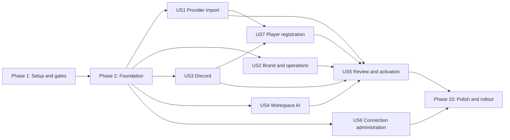

# Tasks: Tournament Setup Wizard, Player Registration, and Workspace AI Keys

**Input**: Design documents from `/specs/004-tournament-setup-wizard/`

**Prerequisites**: `plan.md`, `spec.md`, `research.md`, `data-model.md`, `contracts/`, `quickstart.md`

**Tests**: Required by the feature specification and verification strategy. For each user story, create the listed tests first and confirm they fail for the intended missing behavior before implementation.

**Organization**: Tasks are grouped by user story so separate agents can implement and validate bounded increments. P1 stories precede P2 stories. Shared integration files are assigned only in Setup and Foundational tasks to reduce merge conflicts.

## Format: `[ID] [P?] [Story] Description`

- **[P]**: May run in parallel after the phase prerequisites are complete because it changes distinct files and has no dependency on another unfinished task in the same parallel group.
- **[Story]**: Maps a task to a user story in `spec.md`.
- Every task names the exact file or directory it changes.

## Phase 1: Setup and Safety Gates

**Purpose**: Verify that feature 003 prerequisites are real, define safe rollout controls, and prepare isolated test scaffolding before feature work starts.

- [X] T001 Execute the feature 003 PostgreSQL/workspace identity gate checks and record pass/fail evidence and unresolved blockers in `specs/004-tournament-setup-wizard/evidence/prerequisite-gates.md`
- [X] T002 Inventory every automatic-DQ path, legacy global AI/Discord fallback, global active-bot selector, and legacy player `team`/`name` boundary in `specs/004-tournament-setup-wizard/evidence/legacy-runtime-inventory.md`
- [X] T003 [P] Add disabled-by-default wizard, activation, registration, and provider-start rollout flags with documented defaults in `.env.example` and `backend/core/provider_feature_flags.py`
- [X] T004 [P] Create redacted Start.gg, Challonge, Discord, Gemini, and OpenAI fake fixtures and adapter factories in `backend/tests/fixtures/tournament_setup/`
- [X] T005 [P] Scaffold the isolated React feature module and placeholder route boundary in `frontend-react/src/features/tournament-setup/` and `frontend-react/src/App.tsx`

**Checkpoint**: Do not continue if PostgreSQL/workspace identity is incomplete or any automatic-DQ path remains enabled by default.

---

## Phase 2: Foundational Domain, Storage, and Security

**Purpose**: Establish the shared schema, canonical vocabulary, permissions, redaction, draft infrastructure, and durable effects required by every story.

**Critical**: No user-story implementation starts until T006-T021 pass.

- [X] T006 [P] Add failing PostgreSQL contract tests for non-null workspace ownership, foreign keys, uniqueness, and row isolation for every new aggregate in `backend/tests/test_tournament_setup_schema.py`
- [X] T007 [P] Add failing regression tests proving attendance expiry, worker restart, Discord flows, and assistant flows cannot automatically disqualify players in `backend/tests/test_no_automatic_dq.py`
- [X] T008 Add the draft, connection-health, workspace-AI, provider-binding, call-occurrence, brand, operating-profile, Discord-binding, registration, enrollment, challenge, roster-snapshot, bot-profile, template, readiness, OAuth-state, and idempotency PostgreSQL definitions from `data-model.md` in `backend/core/database_schema.py`
- [X] T009 Implement additive migrations, constraints, migration receipts, canonical `prefix`/`gamertag` backfill, and reversible compatibility boundaries in `backend/core/schema_migrations.py`
- [X] T010 [P] Define canonical domain enums and models for wizard steps, readiness, provider capabilities, registration states, image policy, link status, and `prefix`/`gamertag` in `backend/core/models.py`
- [X] T011 [P] Define safe Pydantic request/response projections that reject secret-shaped draft fields and never emit legacy player aliases in `backend/api/schemas.py`
- [X] T012 [P] Add `tournament.manage`, `integrations.manage`, and `assistant.use` authorization checks with trusted workspace derivation in `backend/core/workspace_auth.py`
- [X] T013 [P] Extend encrypted integration-account lifecycle support for Start.gg, Challonge, Discord, Gemini, and OpenAI with safe health metadata in `backend/core/integrations.py`
- [X] T014 [P] Implement versioned, workspace-scoped draft persistence and lifecycle repositories in `backend/core/tournament_setup.py`
- [X] T015 [P] Implement tournament registration, enrollment, verification-challenge, and roster-snapshot repositories with transactional uniqueness in `backend/core/player_registration.py`
- [X] T016 [P] Implement explicit workspace/guild/tournament Discord binding lookup that fails closed on missing or ambiguous routes in `backend/core/bot_routing.py`
- [X] T017 [P] Extend the durable outbox for schedule-versioned registration jobs, initial synchronization, provider start, and call-occurrence delivery keys in `backend/core/workflow_outbox.py`
- [X] T018 Add centralized safe provider/AI/Discord error classification, response redaction, and audit-detail allow lists in `backend/core/integrations.py` and `backend/tests/test_tournament_setup_redaction.py` after T013
- [X] T019 Remove automatic-DQ schema defaults, timer invocations, API wording, and bot actions while retaining reminders and human escalation in `backend/core/auto_dispatcher/service.py`, `backend/api/routers/settings.py`, and `backend/bot/main.py`
- [X] T020 Create and register feature router shells once in `backend/api/main.py`, `backend/api/routers/__init__.py`, `backend/api/routers/tournament_setup.py`, `backend/api/routers/player_registration.py`, and `backend/api/routers/discord_oauth.py` so story agents only edit their assigned router modules
- [X] T021 Run the foundational PostgreSQL, migration, workspace-isolation, secret-redaction, and no-automatic-DQ suites and save the command/results in `specs/004-tournament-setup-wizard/evidence/foundation-tests.md`

**Checkpoint**: The new schema is available dark, all resources are workspace-owned, secrets fail closed, canonical names are defined, and no runtime path can auto-DQ.

---

## Phase 3: User Story 1 - Import the Intended Tournament Event (Priority: P1) - MVP

**Goal**: Let an authorized organizer select a reusable customer-owned Start.gg or Challonge connection, resolve a locator without persistence, and confirm the exact Event or bracket scope.

**Independent Test**: Resolve a direct Start.gg Event slug/URL, a multi-Event tournament URL, and a Challonge bracket using fake accounts; verify exact selection, explicit choice, safe failure, and draft preservation.

### Tests for User Story 1

- [X] T022 [P] [US1] Add failing Start.gg resolver contract tests for direct Event preservation, zero/one/many Event handling, stale access, and prohibition of implicit `events[0]` selection in `backend/tests/test_provider_resolution_startgg.py`
- [X] T023 [P] [US1] Add failing Challonge resolver contract tests for exact account use, one-bracket preview, subdomain handling, and non-persistence in `backend/tests/test_provider_resolution_challonge.py`
- [ ] T024 [P] [US1] Add failing frontend tests for account selection, Event slug entry, explicit multi-Event choice, retryable errors, and retained draft values in `frontend-react/src/features/tournament-setup/__tests__/ProviderStep.test.tsx`

### Implementation for User Story 1

- [X] T025 [P] [US1] Implement provider-neutral locator parsing, provenance, freshness, capability projection, and safe resolution errors in `backend/core/provider_discovery.py`
- [X] T026 [P] [US1] Implement direct Event and tournament-level resolution without slug truncation or implicit Event selection in `backend/core/providers/startgg/discovery.py`
- [X] T027 [P] [US1] Implement exact Challonge tournament resolution as one managed bracket in `backend/core/providers/challonge/discovery.py`
- [X] T028 [US1] Implement resolve and scope-selection endpoints with revision checks and draft-preserving failure behavior in `backend/api/routers/providers.py`
- [X] T029 [P] [US1] Implement typed provider/account/resolution API clients in `frontend-react/src/features/tournament-setup/api.ts` and `frontend-react/src/features/tournament-setup/types.ts`
- [X] T030 [P] [US1] Build the account chooser, Connect Start.gg/Challonge actions, locator field, scope cards, provenance, and error remediation in `frontend-react/src/features/tournament-setup/components/ProviderStep.tsx`
- [X] T031 [US1] Integrate provider resolution and explicit scope selection with optimistic draft state in `frontend-react/src/features/tournament-setup/store.ts`
- [X] T032 [US1] Run US1 backend and frontend tests and capture exact-Event selection evidence in `specs/004-tournament-setup-wizard/evidence/us1-provider-import.md`

**Checkpoint**: US1 works as an independently demonstrable MVP and creates no active tournament.

---

## Phase 4: User Story 2 - Review Branding and Safe Operating Defaults (Priority: P1)

**Goal**: Separate provider facts from local presentation, provide safe manual/assisted presets, expose Start-in-wave truthfully, and unify every real `CALLED` transition into one Discord-call occurrence.

**Independent Test**: Review incomplete provider metadata, add a local identity/logo, choose Assisted, verify no automatic DQ, then create the same `CALLED` occurrence from provider and Dashboard sources and observe one queued delivery.

### Tests for User Story 2

- [X] T033 [P] [US2] Add failing unit tests for provider-fact provenance, brand fallback, preset expansion, unfinished-match thresholds, and wave status projection in `backend/tests/test_tournament_review_profile.py`
- [X] T034 [P] [US2] Add failing concurrency tests for provider/Dashboard `CALLED` transitions, first-wave handling, duplicate snapshots, restart, and one durable call occurrence in `backend/tests/test_match_call_occurrences.py`
- [ ] T035 [P] [US2] Add failing frontend tests for read-only provider facts, local branding, logo states, advanced defaults, no DQ control, and Start-in-wave confirmation/revocation in `frontend-react/src/features/tournament-setup/__tests__/TournamentStep.test.tsx`

### Implementation for User Story 2

- [X] T036 [P] [US2] Implement tournament brand validation, provider/local provenance projection, and shared identity fallback rules in `backend/core/tournament_brand.py`
- [X] T037 [P] [US2] Implement versioned Manual and Assisted preset expansion, tournament overrides, and readiness guards without automatic DQ in `backend/core/tournament_operating_profile.py`
- [X] T038 [P] [US2] Add draft-logo ownership, validation, deletion, and atomic rebind support to the existing media pipeline in `backend/core/image_store.py`
- [X] T039 [P] [US2] Implement Start-in-wave read capability, organizer confirmation audit/revocation, freshness rules, and monitoring states in `backend/core/providers/startgg/wave_monitor.py`
- [X] T040 [US2] Implement the transactional match call-occurrence service and canonical idempotency key shared by provider and Dashboard transitions in `backend/core/match_commands.py`
- [X] T041 [US2] Feed fresh Start.gg bracket-start and `CALLED` transitions, including the first wave, into the canonical occurrence service in `backend/core/provider_sync_manager.py`
- [X] T042 [US2] Route authorized Dashboard `CALLED` changes through the same occurrence service and preserve source metadata in `backend/api/routers/matches.py`
- [X] T043 [US2] Implement tournament review, operating-profile, wave confirmation, and logo endpoints in `backend/api/routers/tournament_setup.py` and `backend/api/routers/assets.py`
- [X] T044 [P] [US2] Project the reviewed tournament identity to Hub, Editor, and authorized overlay payloads in `backend/core/provider_projection.py`
- [X] T045 [P] [US2] Build the provider-facts, branding, presets, advanced operating settings, and wave-status UI in `frontend-react/src/features/tournament-setup/components/TournamentStep.tsx`
- [X] T046 [US2] Run US2 suites and record logo preservation plus single-call-occurrence evidence in `specs/004-tournament-setup-wizard/evidence/us2-brand-operations.md`

**Checkpoint**: Brand and operating profile are independently reviewable; all call sources converge on one durable occurrence and none can auto-DQ.

---

## Phase 5: User Story 3 - Connect Discord and Tailor the Bot Experience (Priority: P1)

**Goal**: Install the managed aiTOB bot, bind one permitted guild and destinations, verify effective permissions, and preview validated tournament messages.

**Independent Test**: Complete authorization against a fake guild, select destinations and role, detect one channel overwrite failure, preview a customized template, and verify that skipped Discord leaves manual operation ready.

### Tests for User Story 3

- [X] T047 [P] [US3] Add failing OAuth state, callback recovery, guild authorization, and cross-workspace isolation tests in `backend/tests/test_discord_onboarding.py`
- [X] T048 [P] [US3] Add failing routing and effective-permission tests for two workspaces/guilds, threads, missing routes, and ambiguous routes in `backend/tests/test_discord_routing_wizard.py`
- [X] T049 [P] [US3] Add failing template-variable, escaping, length, empty-message, preview/delivery parity, and locale tests in `backend/tests/test_discord_templates.py`
- [ ] T050 [P] [US3] Add failing frontend tests for optional enablement, OAuth restoration, named resource selection, permission remediation, and template previews in `frontend-react/src/features/tournament-setup/__tests__/DiscordStep.test.tsx`

### Implementation for User Story 3

- [X] T051 [P] [US3] Implement hashed one-use Discord authorization state and safe callback recovery bound to workspace, actor, draft, and return step in `backend/api/routers/discord_oauth.py`
- [X] T052 [P] [US3] Implement safe guild/channel/thread/role discovery and effective permission calculations including channel overwrites in `backend/core/discord_resources.py`
- [X] T053 [P] [US3] Implement bot experience inheritance, supported-variable registry, shared renderer, escaping, and destination length limits in `backend/core/tournament_templates.py`
- [X] T054 [US3] Implement Discord resource, recheck, and message-preview endpoints with safe projections in `backend/api/routers/integrations.py`
- [ ] T055 [US3] Replace process-global active workspace/account selection with explicit inbound and outbound routing in `backend/bot/main.py`
- [ ] T056 [P] [US3] Route match calls, reminders, result receipts, clarifications, and escalations through the validated renderer in `backend/bot/messages.py`
- [X] T057 [P] [US3] Build Discord enablement, connection, resource, permissions, behavior, locale, tone, and template panels in `frontend-react/src/features/tournament-setup/components/DiscordStep.tsx`
- [ ] T058 [US3] Integrate Discord OAuth return restoration and permission/readiness state into `frontend-react/src/features/tournament-setup/store.ts`
- [X] T059 [US3] Run US3 suites and record two-guild routing, permission, template, and optional-skip evidence in `specs/004-tournament-setup-wizard/evidence/us3-discord.md`

**Checkpoint**: Discord can be configured or skipped without global routing assumptions, and previewed output matches delivery rendering.

---

## Phase 6: User Story 4 - Use a Workspace-Owned AI Connection (Priority: P1)

**Goal**: Preserve current assistant controls while each workspace stores, selects, tests, rotates, disables, and removes its own Gemini/OpenAI key with no platform credential fallback.

**Independent Test**: Configure different providers and keys in two workspaces, preserve settings, exercise safe error categories and rotation, and prove that only new requests use the replacement key.

### Tests for User Story 4

- [X] T060 [P] [US4] Add failing encrypted credential lifecycle, wrong-master-key, redaction, permission, and two-workspace isolation tests in `backend/tests/test_workspace_ai_credentials.py`
- [X] T061 [P] [US4] Add failing assistant configuration, provider selection, quota reservation, rotation-race, and no-hidden-fallback tests in `backend/tests/test_workspace_ai_config.py`
- [X] T062 [P] [US4] Add failing Gemini/OpenAI adapter classification tests using fakes for invalid key, model, quota, rate limit, timeout, region, and outage in `backend/tests/test_workspace_ai_adapters.py`
- [ ] T063 [P] [US4] Add failing frontend tests for write-only key fields, role restrictions, preserved assistant controls, deliberate-test warning, and future-capability disabled states in `frontend-react/src/features/tournament-setup/__tests__/AssistantStep.test.tsx`

### Implementation for User Story 4

- [X] T064 [P] [US4] Implement Gemini invocation and deliberate minimal connection-test adapter with classified safe failures in `backend/core/ai_providers/gemini.py`
- [X] T065 [P] [US4] Implement OpenAI invocation and deliberate minimal connection-test adapter with classified safe failures in `backend/core/ai_providers/openai.py`
- [X] T066 [US4] Implement workspace-wide provider/account/model/mode/limits/timeout/policy configuration and row-locked usage reservations in `backend/core/ai_service.py`
- [X] T067 [US4] Resolve assistant credentials from the authenticated workspace and selected account, enforce `assistant.use`, and remove all global fallback behavior in `backend/bot/agent/graph.py`
- [X] T068 [US4] Implement safe AI configuration and credential add/replace/test/enable/disable/remove endpoints in `backend/api/routers/ai_service.py`
- [X] T069 [P] [US4] Implement the explicit audited one-workspace legacy AI assignment command without automatic secret copying in `backend/scripts/assign_legacy_ai_config.py`
- [X] T070 [P] [US4] Extend central AI settings with Gemini/OpenAI connection cards, write-only inputs, safe status, and preserved controls in `frontend-react/src/features/hub/components/AISettings.tsx`
- [X] T071 [P] [US4] Build the wizard assistant step as a workspace-setting view/editor with no tournament override in `frontend-react/src/features/tournament-setup/components/AssistantStep.tsx`
- [X] T072 [US4] Run US4 suites and record encryption, redaction, isolation, rotation, accounting, and no-fallback evidence in `specs/004-tournament-setup-wizard/evidence/us4-workspace-ai.md`

**Checkpoint**: AI billing and credentials belong to the customer workspace; AI failure cannot block non-AI tournament operation.

---

## Phase 7: User Story 7 - Register and Verify Tournament Players in Discord (Priority: P1)

**Goal**: Operate a tournament-scoped registration window, synchronize the exact provider roster, verify identity through configured methods, support manual Discord ID links, and enforce image readiness.

**Independent Test**: Run Start.gg and Challonge registration flows before/during/after the window, with exact Gamertag, nickname, optional Start.gg bio, Discord-only enrollment, manual ID link/edit/unlink, collisions, roster removal, and all image policies.

### Tests for User Story 7

- [X] T073 [P] [US7] Add failing server-time window, schedule-version, open/close/reminder job, restart, and organizer-after-close correction tests in `backend/tests/test_registration_window.py`
- [X] T074 [P] [US7] Add failing exact-scope roster, `prefix`/`gamertag` mapping, membership reuse, removal, freshness, collision, and idempotent diff tests in `backend/tests/test_registration_sync.py`
- [X] T075 [P] [US7] Add failing exact Discord-name, nickname-change, optional Start.gg bio, challenge expiry/replay/attempt, and Challonge no-bio tests in `backend/tests/test_registration_identity.py`
- [X] T076 [P] [US7] Add failing manual Discord ID add/replace/unlink tests for snowflake format, bot, wrong guild, uniqueness, audit, and queued-effect reconciliation in `backend/tests/test_registration_manual_discord_link.py`
- [X] T077 [P] [US7] Add failing deterministic image validation and disabled/optional/required readiness tests proving no AI provider call occurs in `backend/tests/test_registration_images.py`
- [ ] T078 [P] [US7] Add failing frontend tests for registration configuration, Prefix/Gamertag columns, state filters, corrective actions, manual Discord ID states, and provider-specific verification controls in `frontend-react/src/features/tournament-setup/__tests__/PlayerRegistration.test.tsx`

### Implementation for User Story 7

- [X] T079 [P] [US7] Map Start.gg entrant prefix and competitive Gamertag separately and expose exact Event roster pages in `backend/core/providers/startgg/entrants.py`
- [X] T080 [P] [US7] Map Challonge entrant prefix and competitive Gamertag separately and expose exact bracket roster pages in `backend/core/providers/challonge/entrants.py`
- [X] T081 [US7] Implement idempotent exact-scope roster snapshots, diffs, freshness, enrollment updates, and explicit recheck in `backend/core/registration_sync.py`
- [X] T082 [P] [US7] Implement exact documented Gamertag normalization, collision detection, Discord-name comparison, and provider-specific method availability in `backend/core/registration_identity.py`
- [X] T083 [P] [US7] Implement authorized server nickname changes with permission checks and review-state failures in `backend/core/discord_member_identity.py`
- [X] T084 [P] [US7] Implement keyed-hash, one-use, attempt-limited Start.gg bio challenges bounded by registration close and discard fetched bio/plaintext after comparison in `backend/core/startgg_bio_verification.py`
- [X] T085 [US7] Implement manual Discord ID resolution, non-bot guild membership validation, one-to-one transactional linking, replacement, unlink, and authoritative future routing in `backend/core/player_registration.py`
- [X] T086 [P] [US7] Implement deterministic player-image decode/type/size/dimension/normalization checks and keep/replace/skip behavior in `backend/core/player_image_service.py`
- [X] T087 [US7] Implement schedule-versioned open/close announcements, registration actions, reminders, role grants, and retry-safe transitions in `backend/core/runtime_tasks.py`
- [ ] T088 [US7] Replace global registration scanning with signed workspace/tournament/guild/destination interaction routing and window enforcement in `backend/bot/registration.py`
- [X] T089 [US7] Implement registration config, list/filter, recheck, manual-link, approval, image-correction, rejection, open, and close endpoints in `backend/api/routers/player_registration.py`
- [X] T090 [P] [US7] Migrate API/import/export/editor/bot projections to canonical `prefix` and `gamertag`, retaining deprecated aliases only in `backend/core/legacy_player_adapter.py`
- [X] T091 [P] [US7] Build the registration configuration card, provider-specific verification choices, schedule summary, image policy, and template fields in `frontend-react/src/features/tournament-setup/components/PlayerRegistrationCard.tsx`
- [X] T092 [P] [US7] Build the enrollment status drawer with filters, Prefix/Gamertag/Discord columns, evidence summary, and contextual link/recheck/review actions in `frontend-react/src/features/tournament-setup/components/RegistrationStatusDrawer.tsx`
- [X] T093 [US7] Run US7 suites and record two-tournament routing, window, roster, identity, manual-link, image, and no-auto-DQ evidence in `specs/004-tournament-setup-wizard/evidence/us7-player-registration.md`

**Checkpoint**: Registration is bound to one tournament and provider scope, every ready player has safe routing, and unresolved identity/image cases remain reviewable without provider mutation.

---

## Phase 8: User Story 5 - Review, Save, Activate, and Start Safely (Priority: P2)

**Goal**: Show one truthful readiness summary and keep Save draft, Save tournament, Activate aiTOB, and Start provider bracket as distinct idempotent actions.

**Independent Test**: Materialize and activate with ready/optional/blocked combinations, replay idempotency keys, recover after a commit-before-sync crash, then preflight and start disposable fake Start.gg and Challonge brackets with verified resulting states and unknown-outcome reconciliation.

### Tests for User Story 5

- [X] T094 [P] [US5] Add failing grouped-readiness and correction-link tests for provider, tournament, Discord, registration, and optional AI checks in `backend/tests/test_tournament_readiness.py`
- [X] T095 [P] [US5] Add failing materialization/activation transaction, concurrent replay, crash recovery, and initial-sync outbox tests in `backend/tests/test_tournament_activation.py`
- [ ] T096 [P] [US5] Add failing Start.gg and Challonge remote-start contract tests for capability, permission, freshness, confirmation, idempotency, resulting state, timeout, and reconciliation in `backend/tests/test_provider_remote_start.py`
- [ ] T097 [P] [US5] Add failing frontend tests for status cards, edit links, focus on error, optional warnings, and four distinct final actions in `frontend-react/src/features/tournament-setup/__tests__/ReviewStep.test.tsx`

### Implementation for User Story 5

- [ ] T098 [P] [US5] Implement server-owned grouped readiness with freshness budgets, required blockers, optional warnings, and precise field remediation in `backend/core/tournament_readiness.py`
- [X] T099 [US5] Implement draft locking, revision revalidation, atomic tournament/child materialization, and idempotent replay in `backend/core/tournament_setup.py`
- [X] T100 [US5] Implement local activation, post-commit initial-sync outbox insertion, replay handling, and recovery state in `backend/core/tournament_activation.py`
- [X] T101 [P] [US5] Implement the documented or provider-authorized Start.gg remote-start adapter with fresh preflight and state reconciliation in `backend/core/providers/startgg/remote_start.py`
- [X] T102 [P] [US5] Implement the documented or provider-authorized Challonge remote-start adapter with fresh preflight and state reconciliation in `backend/core/providers/challonge/remote_start.py`
- [X] T103 [US5] Implement readiness, materialize, activate, and confirmed provider-start endpoints with redacted audits in `backend/api/routers/tournament_setup.py`
- [X] T104 [P] [US5] Implement allow-listed setup-template creation that excludes identifiers, credentials, dates, player data, and test details in `backend/core/tournament_templates.py`
- [X] T105 [P] [US5] Build the review cards, direct edit navigation, accessible error summary, and separate save/materialize/activate/provider-start controls in `frontend-react/src/features/tournament-setup/components/ReviewStep.tsx`
- [X] T106 [US5] Run US5 suites and record idempotency, crash recovery, both provider-start contracts, resulting-state verification, and unknown-outcome evidence in `specs/004-tournament-setup-wizard/evidence/us5-activation-start.md`

**Checkpoint**: Local activation is recoverable and separate from external start; both providers have authorized, verified remote-start contracts or the Epic remains blocked.

---

## Phase 9: User Story 6 - Resume and Administer Connections Outside the Wizard (Priority: P2)

**Goal**: Manage reusable workspace connections and non-secret defaults centrally, reuse them in multiple drafts, and surface degraded readiness after rotation, disablement, or removal.

**Independent Test**: Create two drafts from central connections/defaults, rotate and disable one connection, verify no secret is exposed, and replace the binding without losing either tournament configuration.

### Tests for User Story 6

- [ ] T107 [P] [US6] Add failing reusable account/default/template, multi-draft reuse, rotation, disable/remove degradation, and replacement-binding tests in `backend/tests/test_connection_administration.py`
- [ ] T108 [P] [US6] Add failing frontend tests for central provider/Discord/AI connection status, permission-gated actions, safe replacement, and affected-tournament counts in `frontend-react/src/features/hub/components/__tests__/IntegrationAccounts.test.tsx`

### Implementation for User Story 6

- [X] T109 [US6] Complete reusable provider/Discord/AI account list, create, safe test, rotate, enable, disable, remove, and dependency projection endpoints in `backend/api/routers/integrations.py`
- [X] T110 [P] [US6] Implement non-secret workspace defaults and allow-listed setup-template repositories with tournament override provenance in `backend/core/tournament_templates.py`
- [ ] T111 [US6] Recompute dependent tournament readiness without deleting bindings when a connection lifecycle changes in `backend/core/tournament_readiness.py`
- [ ] T112 [P] [US6] Build the central reusable connection manager with provider identity, health, last test, permissions, and no secret retrieval in `frontend-react/src/features/hub/components/IntegrationAccounts.tsx`
- [X] T113 [P] [US6] Build resumable-draft listing, abandoned/materialized states, and central setup-template selection in `frontend-react/src/features/tournament-setup/components/DraftLauncher.tsx`
- [X] T114 [US6] Run US6 suites and record reuse, rotation, degraded-readiness, replacement, and non-secret projection evidence in `specs/004-tournament-setup-wizard/evidence/us6-connections.md`

**Checkpoint**: Connections are reusable workspace resources, tournaments retain explicit bindings, and no member can retrieve stored credentials.

---

## Phase 10: Polish and Cross-Cutting Validation

**Purpose**: Complete the integrated wizard shell, accessibility, performance, migration, security, operational evidence, and guarded rollout.

- [X] T115 Implement the five-step accessible shell, step completion, back navigation, URL restoration, debounced versioned autosave, retry/conflict states, and OAuth return recovery in `frontend-react/src/features/tournament-setup/TournamentSetupPage.tsx` and `frontend-react/src/features/tournament-setup/store.ts`
- [ ] T116 [P] Add keyboard-only, focus management, Arabic RTL, English LTR, 44px target, mobile-width, and no-horizontal-scroll acceptance tests in `frontend-react/src/features/tournament-setup/__tests__/WizardAccessibility.test.tsx`
- [ ] T117 [P] Add full API contract tests for permissions, `404` cross-workspace behavior, `If-Match`, idempotency headers, safe problem shapes, and secret-shaped draft rejection in `backend/tests/test_tournament_setup_api_contract.py`
- [ ] T118 [P] Add an automated synthetic-secret scan covering responses, logs, audits, drafts, exports, templates, and safe database columns in `backend/tests/test_tournament_setup_secret_scan.py`
- [X] T119 Add explicit legacy AI assignment, Discord/provider quarantine, player-field migration, and global registration cutover execution steps and receipts in `backend/core/schema_migrations.py` and `specs/004-tournament-setup-wizard/evidence/migration-report.md`
- [ ] T120 [P] Add p95 draft restore/autosave checks and assertions that no database transaction spans a provider/Discord/AI network call in `backend/tests/test_tournament_setup_performance.py`
- [X] T121 [P] Add overlay/Editor/Hub before-and-after projection tests that preserve existing asset URLs and fallback precedence in `backend/tests/test_tournament_brand_projection.py`
- [X] T122 Execute the backend unit and disposable-PostgreSQL suites, frontend test/build, and fake-adapter quickstart; record commands and results in `specs/004-tournament-setup-wizard/evidence/final-validation.md`
- [X] T123 Document operator rollout, pause/reconcile/rollback, credential-key failure, provider unknown outcomes, and disabled-feature behavior in `specs/004-tournament-setup-wizard/runbook.md`
- [X] T124 Enable draft creation first and activation/provider-start only after every blocking evidence item passes, recording flag decisions and approvers in `specs/004-tournament-setup-wizard/evidence/rollout-approval.md`

**Checkpoint**: The wizard is ready for guarded rollout only when all blocking evidence passes; a missing authorized remote-start contract for either provider keeps the Epic blocked.

---

## Dependencies and Execution Order

### Phase Dependencies

- **Phase 1** has no dependency and establishes hard safety gates.
- **Phase 2** depends on Phase 1 and blocks every user story.
- **US1, US2, US3, US4, and US6** may start in parallel after Phase 2.
- **US7** needs the exact provider scope from US1 and Discord binding/routing from US3; its domain tests may use fixtures while those stories finish.
- **US5** consumes the readiness projections of US1, US2, US3, US4, and US7 and is the final functional integration story.
- **Phase 10** follows all stories selected for release and owns shared-file integration and rollout evidence.

### User Story Completion Order

1. Deliver **US1** as the first MVP: connect/select provider, resolve, and confirm exact scope without activation.
2. Run **US2**, **US3**, and **US4** in parallel after the foundation; each remains independently testable with fakes.
3. Begin **US7** when US1 and US3 contracts are stable; registration and roster agents use only feature-local files.
4. Run **US6** in parallel with P1 work because it depends only on shared integration contracts.
5. Complete **US5** after all enabled service readiness providers exist.
6. Complete Phase 10 and keep activation/provider-start flags off until evidence passes.

### Within Each User Story

1. Write the story tests and verify they fail for the intended missing behavior.
2. Implement domain/adapters before API routes.
3. Implement API projections before wiring the React screen.
4. Run the story-specific suite and record evidence at its checkpoint.

---

## Multi-Agent Ownership Plan

| Lane | Primary tasks | Owned paths | Handoff contract |
|---|---|---|---|
| Foundation/integration owner | T001-T021, T115, T119, T122-T124 | `backend/core/database_schema.py`, `backend/core/schema_migrations.py`, `backend/api/main.py`, `backend/api/schemas.py`, `frontend-react/src/App.tsx` | Publishes stable schema, router shells, shared types, and gates before story agents merge |
| Provider and operations agent | T022-T046, T094-T106 provider portions | `backend/core/provider_discovery.py`, `backend/core/providers/`, `backend/core/provider_sync_manager.py`, provider tests | Publishes provider-neutral resolution/capability/start contracts and redacted fixtures |
| Discord and registration agent | T047-T059, T073-T093 | `backend/core/discord_*`, `backend/core/registration_*`, `backend/bot/`, Discord/registration routers and tests | Publishes explicit routing, registration state transitions, and durable effect keys |
| AI and connections agent | T060-T072, T107-T114 | `backend/core/ai_*`, `backend/api/routers/ai_service.py`, integration administration UI/tests | Publishes safe connection projections and workspace-wide assistant configuration |
| Frontend wizard agent | Story tasks under `frontend-react/src/features/tournament-setup/`, T115-T116 | `frontend-react/src/features/tournament-setup/` | Consumes versioned API types; does not modify backend shared schema or router registration |

### Shared-File Rules

- Only the foundation/integration owner edits `backend/core/database_schema.py`, `backend/core/schema_migrations.py`, `backend/api/main.py`, `backend/api/schemas.py`, and `frontend-react/src/App.tsx` during parallel execution.
- Story agents add or edit feature-local modules and expose their integration through the router shells established by T020.
- `backend/core/integrations.py`, `backend/core/tournament_setup.py`, `backend/core/tournament_readiness.py`, `backend/core/tournament_templates.py`, and `frontend-react/src/features/tournament-setup/store.ts` have sequential tasks; acquire the lane owner’s handoff before starting a later task on the same file.
- An agent marks a task complete only after its focused tests pass and its output contract is documented in the referenced evidence file.

---

## Parallel Execution Examples

### After Foundation

Run these lanes concurrently: T022-T032 (US1), T033-T046 (US2), T047-T059 (US3), T060-T072 (US4), and T107-T114 (US6). Start T073-T093 after US1 and US3 publish their contracts.

### US1 Test Batch

Run T022, T023, and T024 in parallel, then T025, T026, and T027 in parallel. Complete T028 before wiring T029-T031.

### US2 Test and Domain Batch

Run T033-T035 in parallel. After expected failures are captured, run T036-T039 in parallel; serialize T040-T043 because they converge on the call path and router.

### US3 Test and Service Batch

Run T047-T050 in parallel. Then run T051-T053 in parallel; complete T054-T056 before integrating T057-T058.

### US4 Adapter and UI Batch

Run T060-T063 in parallel, then T064 and T065 in parallel. T069-T071 may run in parallel after T066-T068 establish the service/API contract.

### US7 Registration Batch

Run T073-T078 in parallel. Then run T079, T080, T082, T083, T084, and T086 in parallel; serialize T081, T085, T087-T090 around repository and routing dependencies. T091 and T092 may run in parallel against the stable API contract.

### US5 Final Actions Batch

Run T094-T097 in parallel, then T098, T101, T102, T104, and T105 in parallel. Serialize materialization, activation, and route integration through T099, T100, and T103.

---

## Implementation Strategy

### MVP First

1. Complete Phases 1 and 2.
2. Complete US1 through T032.
3. Demonstrate exact Event/bracket selection and resumable safe failure without creating or activating a tournament.
4. Keep every external mutation flag disabled while the remaining stories are implemented.

### Incremental Delivery

1. Add US2 for truthful metadata, branding, safe presets, and unified calls.
2. Add US3 for optional managed Discord setup.
3. Add US4 for workspace BYOK while preserving the existing assistant.
4. Add US7 for tournament-scoped player registration after provider and Discord contracts stabilize.
5. Add US6 central administration in parallel with the P1 lanes.
6. Add US5 once all readiness contributors are available.
7. Complete Phase 10 before enabling activation or provider-start actions.

### Merge and Verification Discipline

- Merge foundation changes before story branches or worktrees consume the new schema and shared types.
- Keep provider, Discord/registration, AI, and frontend commits bounded to their ownership paths.
- Require story evidence and focused tests at each checkpoint before merging into the integration lane.
- Rebase or merge the integration baseline before editing any sequential shared file.
- Default CI uses fakes and redacted fixtures; live provider, Discord, and paid AI smoke tests remain explicit and disposable.

## Notes

- Tests precede implementation because the specification explicitly requires backend, PostgreSQL, adapter, frontend, migration, security, and operational acceptance coverage.
- `[P]` never authorizes simultaneous edits to the same file.
- Remote Start.gg and Challonge operations must use documented or provider-authorized contracts. Browser automation, `markSetCalled`, or undocumented mutations do not satisfy T101/T102.
- New API projections emit `prefix` and `gamertag`; `team` and `name` are accepted only through the versioned compatibility adapter.
- Optional Discord and AI omissions produce warnings; required provider scope, local identity, operating profile, and enabled-registration requirements block materialization or activation.
- No task authorizes a live external mutation; live smoke requires disposable accounts and the explicit procedure in `quickstart.md`.
